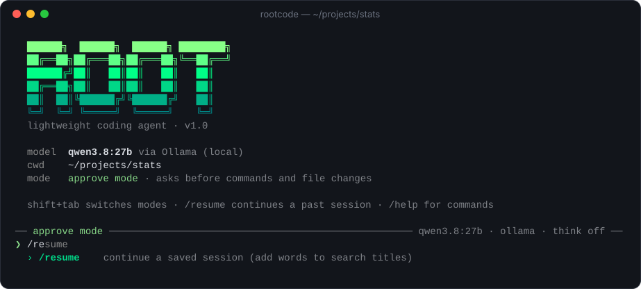
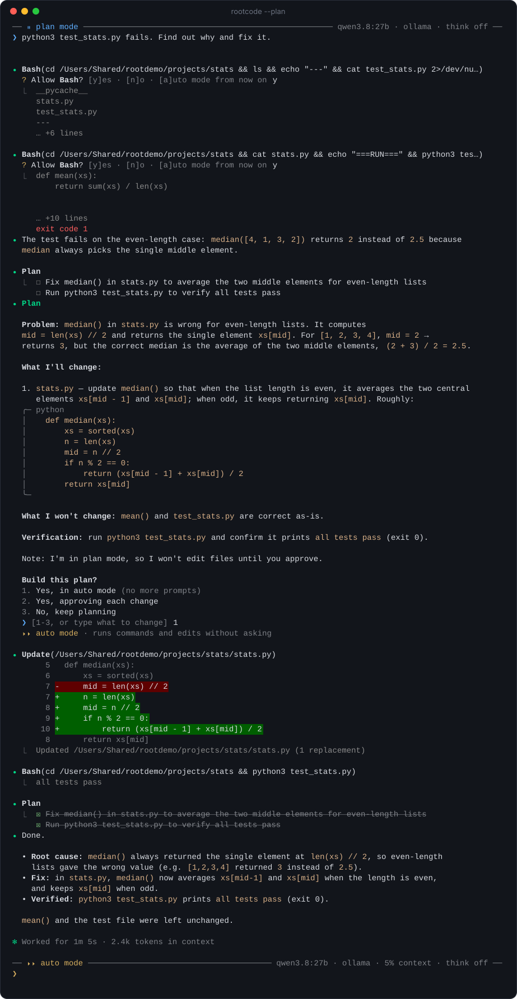

<div align="center">



# Root

**A coding agent for your terminal in one Python file.**<br>
No dependencies. Works with any model, running locally or in the cloud.

<a href="#install"></a>


<a href="LICENSE"></a>

</div>

---

Root reads your code, runs commands, edits files and checks its own work, all from your terminal. It's one Python file that uses only the standard library, so there's nothing to install beyond Python. It works with **Ollama models on your own machine** and with **Anthropic, OpenAI or OpenRouter** in the cloud, and you can switch between them while it runs.

```sh
curl -fsSL https://raw.githubusercontent.com/TreyBros/root-code/main/install.sh | sh
rootcode
```

## Why Root

- 🪶 **Small.** One readable file, standard library only. No `pip install` and no virtualenv, so you can read all of it in an afternoon.
- 🏠 **Local first.** Point it at Ollama, LM Studio or llama.cpp and your code stays on your machine. It's tuned for local models: compact tool output, a nudge when a model stalls, and a switch to turn thinking off for speed.
- 🔌 **Works with many models.** Anthropic, OpenAI, OpenRouter (hundreds of models), Ollama, or any server that speaks the OpenAI API format.
- 🧭 **Three modes.** *Plan* explores your code read-only and proposes a plan for you to approve. *Approve* asks before each change. *Auto* just does the work.
- 💾 **Sessions are saved** to a local SQLite file. Pick up where you left off with `rootcode -c`.
- 🕶️ **Incognito mode.** `/incognito` starts a conversation that never touches the disk. Leaving it wipes the conversation and the screen.

## See it work

A local model (`qwen3.8:27b` on Ollama) in plan mode. It finds why a test fails, proposes a fix, waits for approval, then makes the change and reruns the test:

<div align="center">

</div>

## Install

**One line** (macOS and Linux):

```sh
curl -fsSL https://raw.githubusercontent.com/TreyBros/root-code/main/install.sh | sh
```

This puts `rootcode.py` in `~/.rootcode/` and a `rootcode` command in `~/.local/bin/`. That's all it installs.

**Or from a clone:**

```sh
git clone https://github.com/TreyBros/root-code.git
cd root-code
./install.sh            # installs the rootcode command
python3 rootcode.py     # or just run it, no install needed
```

You need Python 3.9 or newer. That includes the `python3` that ships with macOS.

## Connect a model

Run `rootcode` in any project folder. The first time, it walks you through setup:

1. **Pick a provider.**
2. **Paste an API key** if the provider needs one. Typing is hidden.
3. **Pick a model** from a live list. Type part of a name to filter it.

Root sends a quick test message and only saves your choice if the model answers. Run `/model` anytime to switch.

| Provider | What you need |
|---|---|
| **Ollama** (local) | [Ollama](https://ollama.com) running, with a model pulled, e.g. `ollama pull qwen3.6` |
| **Local server** | LM Studio, llama.cpp, vLLM or anything else that speaks the OpenAI API format. Root asks for its address. |
| **Anthropic** | An API key from [console.anthropic.com](https://console.anthropic.com) |
| **OpenAI** | An API key from [platform.openai.com](https://platform.openai.com) |
| **OpenRouter** | An API key from [openrouter.ai/keys](https://openrouter.ai/keys), which gives you hundreds of models |

API keys can also come from environment variables: `ANTHROPIC_API_KEY`, `OPENAI_API_KEY`, `OPENROUTER_API_KEY`.

## Use it

```sh
rootcode                              # interactive
rootcode "add type hints to utils.py" # one task, then exit
rootcode --plan                       # start in plan mode
rootcode --incognito                  # save nothing from this run
rootcode -c                           # continue the last session in this folder
rootcode --ollama --model=qwen3.6     # pick a provider and model for this run
```

### Modes: press <kbd>Shift</kbd>+<kbd>Tab</kbd> to switch

| Mode | What Root does |
|---|---|
| **approve** *(default)* | Asks before running commands or changing files. Commands that only read, like `ls`, `cat`, `rg`, `git status` and `git diff`, run without asking. |
| **⏵⏵ auto** | Runs commands and makes edits without asking. Best for trusted tasks in a git repo. |
| **⏸ plan** | Read-only. Explores the code, then writes a plan and asks: build it in auto mode, build it approving each change, or keep planning. You can also type feedback and it revises the plan. |

### Incognito

Type `/incognito` (or start with `rootcode --incognito`) for a conversation that leaves no trace. A **◐ incognito** tag shows in the status bar while it's on.

- **Nothing is written to disk.** No saved session, no prompt history and no timing log. <kbd>↑</kbd> still recalls this conversation's prompts, from memory only.
- **Your previous conversation is saved first,** so `/resume` can still bring it back.
- **Leaving it wipes everything.** Run `/incognito` again: the conversation and its prompts are erased from memory, and the screen and scrollback are cleared.
- **Prompts still go to the model.** With a cloud provider, they're sent to that provider. With Ollama or another local server, nothing leaves your machine.

Settings you change with `/model` or `/think`, and files Root writes for you, are saved as usual.

### Commands

Type <kbd>/</kbd> to open the command menu. It narrows as you type and suggests the rest; <kbd>Tab</kbd> accepts the suggestion and <kbd>Enter</kbd> runs the highlighted command.

| Command | |
|---|---|
| `/model` | Switch provider, API key or model |
| `/mode` `/plan` `/approve` `/auto` | Change mode |
| `/think off·low·medium·high` | How hard the model thinks. `off` makes local models much faster. |
| `/resume` | Continue a saved session; add words to search titles |
| `/clear` | Start a new conversation; the current one stays saved |
| `/incognito` | Private conversation that is never saved; run it again to leave and wipe it |
| `/compact` | Summarize the conversation to free up context |
| `/init` | Have Root write a `ROOT.md` with notes on your project for future sessions |
| `/help` · `/exit` | Show help · quit |

### Keys

| Key | Does |
|---|---|
| <kbd>↑</kbd> <kbd>↓</kbd> | Earlier prompts (history is saved) |
| <kbd>Shift</kbd>+<kbd>Tab</kbd> | Switch mode in place, even while Root is working; your typed text stays |
| <kbd>Option</kbd>+<kbd>←</kbd>/<kbd>→</kbd> | Jump a word |
| <kbd>Ctrl</kbd>+<kbd>A</kbd> <kbd>E</kbd> <kbd>U</kbd> <kbd>K</kbd> <kbd>W</kbd> | The usual line editing |
| `\` then <kbd>Enter</kbd> | New line (pasting several lines also works) |
| <kbd>Ctrl</kbd>+<kbd>C</kbd> | Stop the model, or clear the line; twice on an empty line quits |

## Tips for local models

- **Give the model room.** Ollama's default context window is small. A coding agent needs 32k–64k tokens. To make a 64k version of a model:
  ```sh
  printf 'FROM qwen3.6\nPARAMETER num_ctx 65536\n' > Modelfile
  ollama create qwen3.6-64k -f Modelfile
  ```
- **Turn thinking off** with `/think off` when a reasoning model spends a minute thinking before each step. On a laptop that's usually the biggest speedup.
- **Watch the spinner.** It shows the model's thoughts as they stream and says when the model is still reading a long conversation, so you can tell slow from stuck.
- **Check the timings.** If something feels slow, `~/.rootcode/log.jsonl` records how long each model call took and how much of that was waiting for the first token.

### Models that can't use tools

Root needs a model that supports **tool calling**, because that's how it reads, edits and runs things. In `/model`, Ollama models without it are marked <code>no tools</code>, and Root's setup check catches them.

Models pulled straight from Hugging Face (`ollama pull hf.co/…`) often ship a chat template with no tool support, even when the model underneath handles tools fine. If it's a fine-tune of a family Ollama already supports, such as Qwen or Gemma, give it the official model's template:

```sh
# 1. See how the official model of the same family formats tools
ollama show --modelfile qwen3.6 | grep -E '^(TEMPLATE|RENDERER|PARSER|CAPABILITY)'

# 2. Write a Modelfile that points at your download and reuses those lines
cat > Modelfile <<'EOF'
FROM hf.co/someone/Qwen-finetune-GGUF:Q4_K_M
RENDERER qwen3.5          # ← the lines from step 1
PARSER qwen3.5
CAPABILITY tools
PARAMETER num_ctx 65536
EOF

# 3. Create the fixed copy (reuses the same weights, no new download)
ollama create qwen-finetune-64k -f Modelfile
```

Then pick `qwen-finetune-64k` in `/model`. If step 1 prints a long `TEMPLATE` block instead of `RENDERER`/`PARSER` lines, copy that block.

## How it works

Root is the simplest loop that works:

1. Send the conversation and six tools to the model: `bash`, `read`, `write`, `edit`, `glob` and `todo`.
2. Run whatever tools the model asks for and send back the results, including errors, as plain text.
3. Repeat until the model replies without asking for a tool. That reply is the answer.

Everything else is about making that loop pleasant and reliable:

- **Two formats cover every provider.** Root speaks the Anthropic Messages API and the OpenAI Chat Completions API directly over HTTP, using only Python's `urllib`. It streams replies and retries rate limits.
- **Long output is trimmed.** Tool output keeps its beginning and end, and long conversations are summarized when the context fills up.
- **Project notes.** If your project has a `ROOT.md`, `AGENTS.md` or `CLAUDE.md`, Root reads it at the start of every session.
- **Your data stays in one folder.** Everything lives in `~/.rootcode/`:

| File | Holds |
|---|---|
| `config.json` | Your provider, model and API keys. Readable only by you. |
| `sessions.db` | Saved conversations (SQLite). Readable only by you. |
| `history.jsonl` | Your prompt history, for ↑ |
| `log.jsonl` | Timing for each model call |

<details>
<summary><b>All settings</b></summary>

Environment variables and flags override the saved settings.

| Variable | Flag | |
|---|---|---|
| `ROOTCODE_PROVIDER` | `--anthropic` `--openai` `--openrouter` `--ollama` `--local` | Provider |
| `ROOTCODE_MODEL` | `--model=…` | Model |
| `ROOTCODE_THINK` | `--think=…` | Thinking level |
| | `--plan` `--auto` | Starting mode |
| | `-c` / `--continue`, `--resume`, `--incognito` | Sessions |
| `ROOTCODE_BASE_URL` | | Send requests to a different address (for a proxy or gateway) |
| `ROOTCODE_COMPACT_TOKENS` | | Context size that triggers a summary (default 140k for cloud models, 48k for Ollama, 24k for other local servers) |
| `ROOTCODE_LOCAL_KEY` | | API key for a local server that needs one |
| `OLLAMA_HOST` | | Ollama address (default `http://localhost:11434`) |
| `NO_COLOR` | | Turn colors off |

</details>

## Good to know

- **Root runs real commands on your machine.** Approve mode asks first, but auto mode does not, and Root is not a sandbox. Use auto mode in a git repo you can roll back.
- **API keys you enter in `/model` are stored as plain text** in `~/.rootcode/config.json`, which only your user can read. If you'd rather not store them, use environment variables instead.
- **Platforms:** built and tested on macOS. Linux should work, since Root only uses standard POSIX terminal features. On Windows it falls back to a plain input line and hasn't been tested.

## Uninstall

```sh
rm -rf ~/.rootcode ~/.local/bin/rootcode
```

## License

[MIT](LICENSE)
